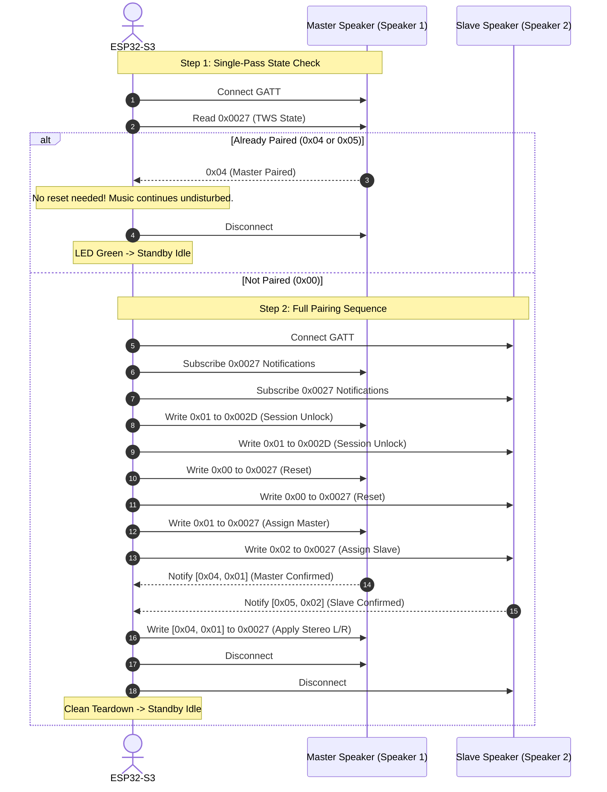

# Bang & Olufsen Beolit 20 BLE Protocol Specification

This document details the reverse-engineered Bluetooth Low Energy (BLE) protocol used by the Bang & Olufsen mobile app to configure **True Wireless Stereo (TWS)** pairing and stereo modes on Bang & Olufsen Beolit 20 speakers.

---

## 1. Overview & GATT Services

The Beolit 20 advertises the standard Bang & Olufsen 16-bit GATT Service UUID: `0xFE89`.

### GATT Hierarchy

| Parameter | UUID | Handle | Permissions / Properties | Description |
|---|---|---|---|---|
| **Service** | `0000fe89-0000-1000-8000-00805f9b34fb` (`0xFE89`) | - | - | Primary B&O Bluetooth Control Service |
| **TWS Characteristic** | `d5b5e4c2-d2a7-4eec-a2d0-6225033a4caf` | `0x0027` | Read, Write, Notify | TWS Control, State Detection & Mode Selection |
| **TWS CCCD** | `00002902-0000-1000-8000-00805f9b34fb` | `0x0028` | Read, Write | Client Characteristic Configuration (Notifications) |
| **Session Characteristic** | `3ba91c2e-8b08-4c27-9d4e-4936a793fcfb` | `0x002D` | Read, Write | Session Unlock / Command Channel Enable |

---

## 2. Protocol Command Codes & OpCodes

### Characteristic `0x0027` (TWS Control)

#### Writes:
- `0x00`: **TWS Reset / Unpair** (Prepares speaker state machine for pairing).
- `0x01`: **Assign Master Role** (Designates speaker as the TWS Master / primary anchor).
- `0x02`: **Assign Slave Role** (Designates speaker as the TWS Slave / secondary satellite).
- `[0x04, 0x01]`: **Stereo Mode L/R** (Master = Left channel, Slave = Right channel).
- `[0x04, 0x02]`: **Stereo Mode R/L** (Master = Right channel, Slave = Left channel - Swapped).
- `[0x04, 0x00]`: **Synced Mode** (Dual-Mono / Party mode; both speakers play full stereo mix).

#### Reads & Notifications:
- `0x00`: **Unpaired / Standalone**
- `0x04`: **Master Paired Confirmation** (Speaker is successfully operating as TWS Master).
- `0x05`: **Slave Paired Confirmation** (Speaker is successfully operating as TWS Slave).
- Notification Payload on Pairing:
  - Master sends: `0x04 0x01`
  - Slave sends: `0x05 0x02`

### Characteristic `0x002D` (Session Control)
- Write `0x01`: Unlocks command processing prior to writing to `0x0027`.

---

## 3. TWS Handshake Sequence Diagram

---

## 4. Reverse-Engineering Methodology

1. **HCI Snoop Logging:**
   - Enabled "Bluetooth HCI snoop log" under Android Developer Options on a smartphone paired with both Beolit 20 speakers.
   - Performed stereo pairing, channel swapping (L/R to R/L), and ambient sync mode switching using the official Bang & Olufsen Android app.
   - Extracted `btsnoop_hci.log` via ADB.
2. **Wireshark Analysis:**
   - Filtered for ATT/GATT protocol packets: `btatt`.
   - Identified the handles (`0x0027`, `0x0028`, `0x002D`) and decoded opcodes and write payloads.
3. **Verification:**
   - Replicated the command flow on ESP32-S3 using `NimBLE-Arduino`.
   - Verified that once the pairing handshake is acknowledged, disconnecting the ESP32 leaves the speakers connected via Classic Bluetooth (SBC / AAC) to the host source device with zero disruption.
